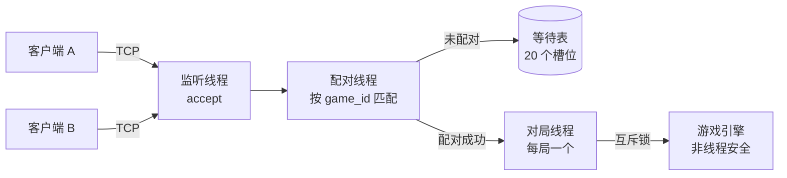
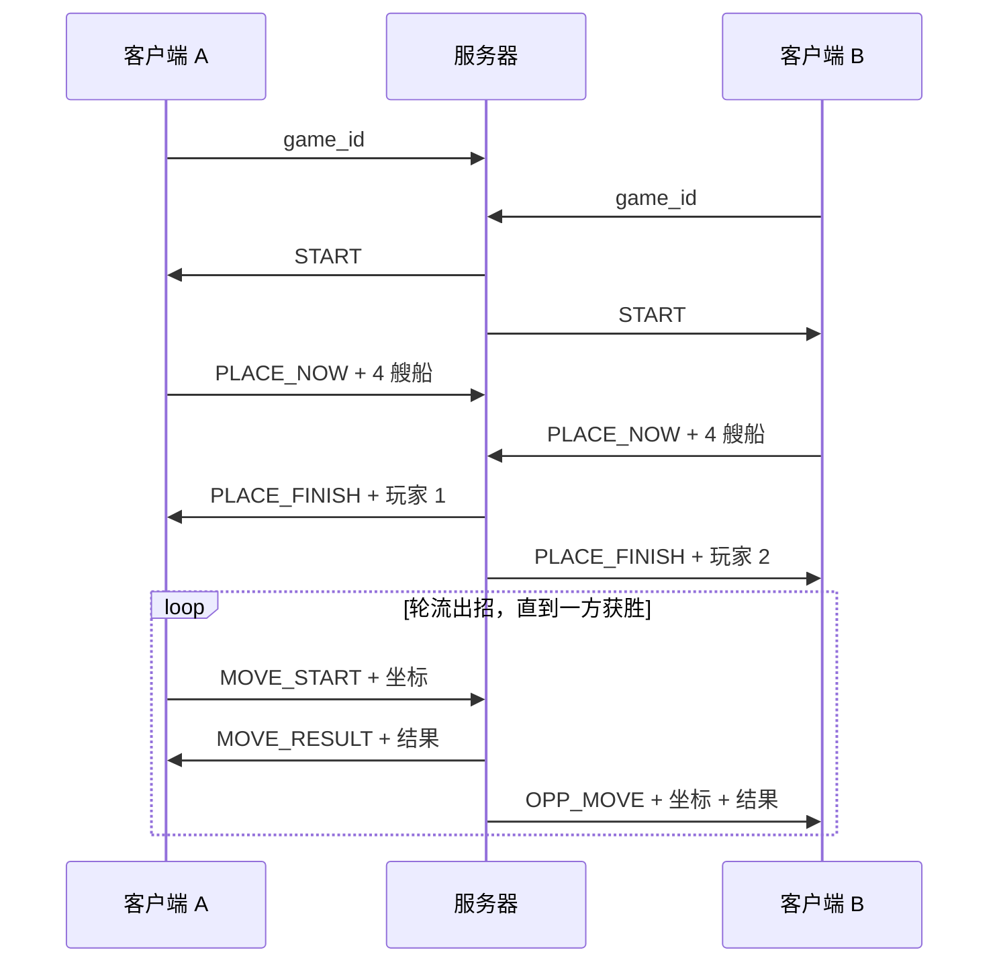

# 联网对战海战棋：客户端 / 服务器

> 2026 年，个人项目，墨尔本大学 COMP30023 Computer Systems 课程作业。
>
> **说明：** 这是课程作业，按学术诚信要求，源代码保存在课程的私有仓库中。本仓库只包含项目介绍，不含源代码，也不含课程提供的游戏引擎和测试程序。如需了解实现细节，可在面试中演示或说明。

## 项目简介

两名玩家通过网络进行海战棋（Battleship）对战：各自摆放 4 艘船，然后轮流向对方棋盘开火，直到一方的船全部被击沉。

我用 C 语言在 Linux 上实现了客户端和服务器两端的网络层：

- **客户端**：连接服务器、加入指定对局、等待对手、提交船只布局、出招，以及接收对手的出招结果。
- **服务器**：接受连接、按对局编号配对两名玩家、转发双方操作，调用游戏引擎判定结果。

游戏规则判定（命中、击沉、胜负）由课程提供的引擎库完成，网络通信、协议设计、并发和错误处理是我实现的部分。

## 系统架构

- 每个新连接由一个独立线程读取 `game_id`，在等待表里找同一对局的另一名玩家。
- 找到就为这两名玩家创建一个对局线程，多局可以同时进行；找不到就登记到等待表。
- 游戏引擎不是线程安全的，所有引擎调用都用一把全局互斥锁保护；等待表用另一把锁保护。

## 通信协议

我设计了一套紧凑的定长二进制协议。每条消息的第一个字节是消息类型，多字节整数统一转成网络字节序。

| 阶段 | 方向 | 内容 | 长度 |
| --- | --- | --- | --- |
| 加入对局 | 客户端 → 服务器 | `game_id`（4 字节，网络字节序） | 4 字节 |
| 开局通知 | 服务器 → 客户端 | `START` | 1 字节 |
| 摆放船只 | 客户端 → 服务器 | `PLACE_NOW` + 4 艘船 ×（坐标 4 字节、长度、方向） | 25 字节 |
| 摆放确认 | 服务器 → 客户端 | `PLACE_FINISH` + 玩家编号 | 2 字节 |
| 出招 | 客户端 → 服务器 | `MOVE_START` + 坐标 | 5 字节 |
| 出招结果 | 服务器 → 出招方 | `MOVE_RESULT` + 结果 | 2 字节 |
| 对手出招 | 服务器 → 等待方 | `OPP_MOVE` + 坐标 + 结果 | 6 字节 |
| 扩展出招结果 | 服务器 → 出招方 | `MOVE_EXT_RES` + 长度（2 字节）+ 变长数据 | 3 + N 字节 |
| 出错 | 服务器 → 双方 | `GAME_ERROR` | 1 字节 |

## 实现要点

- **完整收发：** TCP 是字节流，一次 `read` / `send` 可能只处理一部分数据。我封装了 `read_n` / `write_n`，循环读写直到凑满指定字节数，所有消息都通过它们收发。
- **变长消息：** 扩展出招结果长度不固定，先发 2 字节长度头，再发数据；客户端按长度头分配内存并读满。
- **出错不挂起：** 任何一步读写失败、消息类型不对或引擎拒绝布局，服务器都会通知双方 `GAME_ERROR`、结束对局并关闭连接，不会让另一名玩家一直等待。发送时使用 `MSG_NOSIGNAL`，对端断开不会让整个服务器进程被 `SIGPIPE` 终止。
- **资源边界：** 等待表满时直接拒绝新对局；对局编号已被占用时也返回错误。
- **内存安全：** 收到的坐标会强制补上字符串结尾；客户端返回给调用方的结果由专门的释放函数回收。

## 技术栈

| 类别 | 技术 |
| --- | --- |
| 语言 | C（POSIX） |
| 网络 | TCP Socket（`getaddrinfo`、`bind`、`listen`、`accept`、`connect`） |
| 并发 | pthread 线程、互斥锁 |
| 构建与开发 | Make、静态库、Dev Container、GitHub Actions |

## 我的收获

- 理解了 TCP 字节流和应用层消息之间的区别，以及为什么必须自己处理消息边界。
- 实践了“一连接一线程、一对局一线程”的服务器结构，以及如何用锁保护共享资源。
- 学会把每个失败路径都考虑进协议：联网游戏里，一方断线时另一方也要能正常结束。
